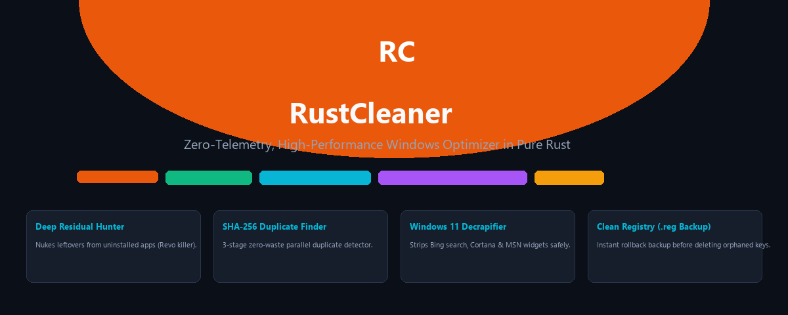
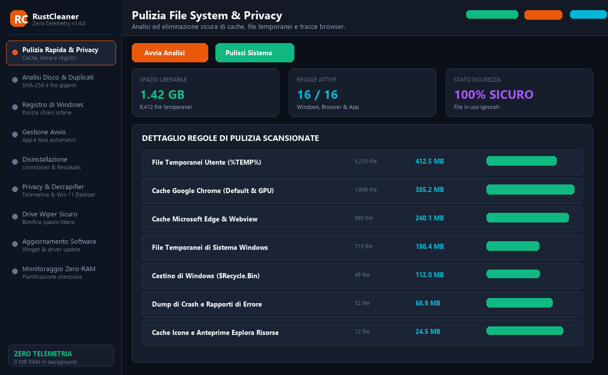
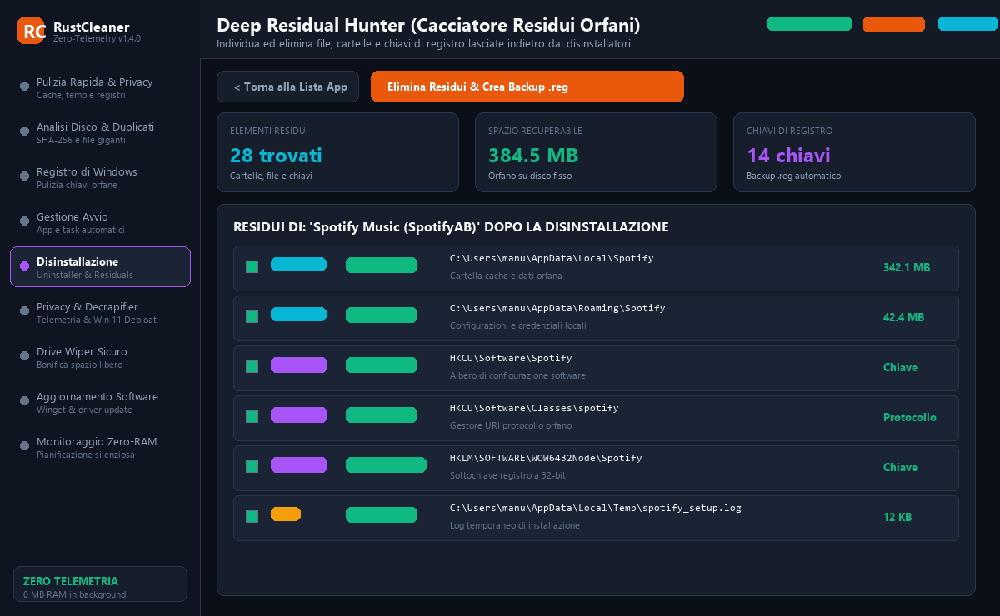
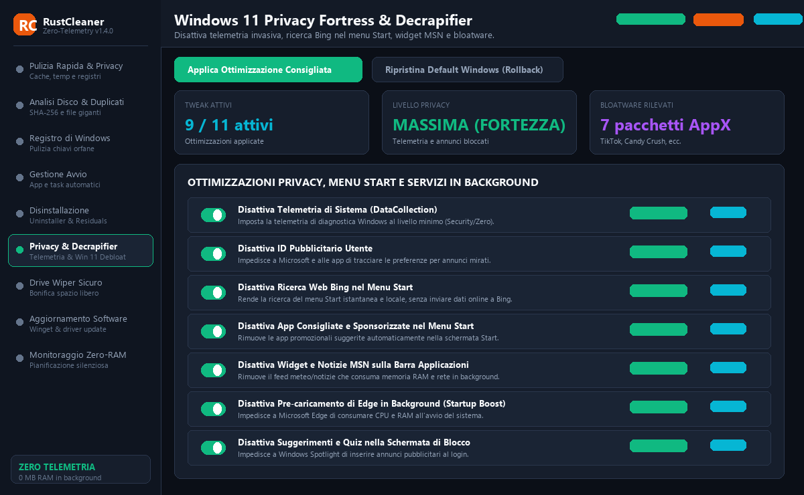
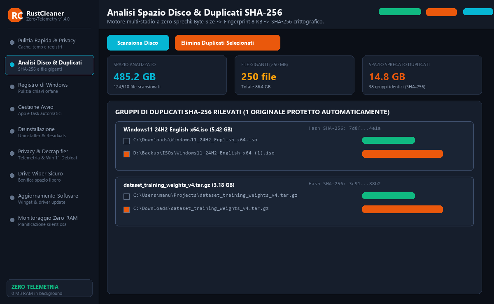

<div align="center">



<br/>

[](https://github.com/Taigher189/RustCleaner/releases)
[](https://www.rust-lang.org/)
[-0078D6?style=for-the-badge&logo=windows&logoColor=white)](https://microsoft.com/windows)
[](#)
[](#)
[](LICENSE)
</div>
<br/>

**The modern, blazing fast, zero-telemetry, single-binary Windows system optimizer, deep residual cleaner, Windows 11 privacy fortress, and disk sanitizer written in pure Rust.**

[Download Latest Portable (.exe)](https://github.com/Taigher189/RustCleaner/releases/latest) • [Key Features](#-killer-features) • [Comparison](#-comparison-matrix) • [CLI Commands](#-command-line-interface-cli) • [Build](#-build-from-source)

---

### 🎥 Watch RustCleaner in Action


</div>

<br/>

## 🌟 Why RustCleaner?

Most traditional Windows maintenance tools (like CCleaner or commercial uninstallers) have become bloated: background telemetry daemons, persistent tray agents eating 100+ MB of RAM, bundled trialware, and upsell popups.

**RustCleaner changes the game:**
- 🛡️ **Zero Telemetry & 100% Offline**: No network tracking, no analytics, no cloud telemetry.
- ⚡ **Zero-RAM Footprint**: Leverages native Windows Task Scheduler (`schtasks.exe`) and Win32 `ReadDirectoryChangesW` kernel events. Consumes **0 MB RAM** when idle.
- 📦 **Single Portable Executable (~7.4 MB)**: Statically linked CRT with native Win32/COM bindings. No installers, no runtimes, no dependencies.
- 🔒 **Ironclad Safety First**: Every registry modification and leftover purge automatically exports an undo `.reg` backup before touching any key.
- 🌐 **7 Built-in Languages**: English, Italian, French, Spanish, German, Chinese, and Portuguese.

---

## 🚀 Killer Features

### 1. 🏹 Deep Residual Hunter (Revo Uninstaller Alternative)
Traditional Windows uninstallers leave behind thousands of orphaned registry values, cache directories, and AppData folders.
- **Recursive App Residue Scanner**: Deep-scans `AppData\Local`, `AppData\Roaming`, `ProgramData`, and Windows Registry hives (`HKCU` & `HKLM` `Software\`, `CurrentVersion\Uninstall`).
- **Global Orphan Detector**: Identifies remnant folders and registry keys from software already deleted months ago.
- **Automated Rollback Backup**: Automatically generates timestamped `Windows Registry Editor Version 5.00` (`.reg`) backup files in `registry_backups/` before deleting anything.
- **Critical Path Blacklist**: Hardened guardrails preventing accidental deletion of vital Windows, system drivers, or system-critical binaries.

### 2. 🛡️ Windows 11 Privacy Fortress & Decrapifier
Reclaim your PC privacy and declutter Windows 11 in one click:
- **Telemetry & Diagnostics Lockdown**: Disables Connected User Experiences (DiagTrack), Customer Experience Improvement Program (CEIP), Advertising ID, and Lock Screen tips.
- **Taskbar & Explorer De-bloating**: Disables Bing web search in Start Menu, Copilot/Cortana widgets, and resets Explorer to clean performance defaults.
- **AppX Consumer Bloatware Remover**: Safely purges pre-installed partner junk (TikTok, Candy Crush, MSN News, Disney+, McAfee) via asynchronous PowerShell AppX engine.
- **1-Click Factory Restore**: Easily restore all stock Windows defaults whenever needed.

### 3. 🔍 Disk Space Analyzer & Multi-Stage SHA-256 Duplicate Finder
- **3-Stage Fast Duplicate Detection**:
  1. Exact File Size matching.
  2. 8 KB Boundary Header/Footer Fingerprinting (eliminates 99% of false positives instantly).
  3. Full Cryptographic SHA-256 Verification.
- **Interactive Disk Visualizer**: Visual category breakdown (Videos, Archives, Executables, Documents, Code) and large file hunter.

### 4. 🧩 Safe Direct Registry Cleaner
- Deep scans orphaned `SharedDLLs`, broken `App Paths`, unmapped file extensions (`FileExts`), stale `MuiCache`, obsolete `AppCompatFlags`, and orphaned `Installer` references.
- Mandatory `.reg` rollback export generated prior to any registry repair.

### 5. 💿 Low-Level Free Space Wiper
- Sanitizes unallocated drive sectors to prevent forensic file recovery without harming your existing files or OS.
- Supports **Zero Fill (1-pass)**, **DoD 5220.22-M (3-pass)**, **NSA (7-pass)**, and **Gutmann (35-pass)** algorithms with unbuffered direct disk I/O (`FILE_FLAG_WRITE_THROUGH`).

### 6. 🔄 Winget & Official Driver Updater
- **Software Updates**: Queries official Microsoft Winget repositories (`winget upgrade`) with 1-click silent updates.
- **Hardware Drivers**: Directly talks to Microsoft's official Windows Update Agent (`WUApiLib` COM interface) to pull certified WHQL drivers without proprietary databases.

---

## 📊 Comparison Matrix

| Feature / Metric | 🦀 **RustCleaner** | 🟠 **CCleaner** | 🔵 **Revo Uninstaller** | ⚪ **BleachBit** |
| :--- | :---: | :---: | :---: | :---: |
| **Idle Memory Consumption** | **0 MB** *(Task Scheduler)* | 80 – 150 MB *(Daemon)* | Manual Only | **0 MB** |
| **Telemetry & Tracking** | 🚫 **Zero (100% Offline)** | ⚠️ Heavy (Avast analytics) | ⚠️ Moderate | 🚫 None |
| **Distribution** | ⚡ **Single Portable .exe (~7 MB)** | Installer (~50 MB) | Multi-file Installer | Python + GTK (~20 MB) |
| **Deep Residual Uninstaller** | ✅ **Included (Free)** | 🔒 Paid Pro Only | 🔒 Paid Pro ($25+) | ❌ No |
| **Windows 11 Privacy & Decrapifier** | ✅ **Included (Free)** | ❌ No | ❌ No | ⚠️ Limited |
| **SHA-256 Multi-Stage Deduplicator**| ✅ **Included** | ⚠️ Basic Size Check | ❌ No | ❌ No |
| **Automated .reg Rollback Backup** | ✅ **Mandatory / Automatic** | ⚠️ Optional Prompt | ⚠️ System Restore Point | ❌ No Registry Tool |
| **Free Space Sanitizer (DoD/Gutmann)**| ✅ **Native Win32 I/O** | 🔒 Paid Pro Only | 🔒 Paid Pro Only | ✅ Included |
| **Winget & WHQL Driver Updater** | ✅ **Official MS APIs Only** | 🔒 Upsell / Proprietary DB | ❌ No | ❌ No |
| **License** | 🟢 **100% Free & Open Source (MIT)** | Freemium / Nagware | Proprietary ($25+) | 🟢 Open Source (GPL-3.0) |

---

## 📸 Screenshots Gallery

<div align="center">
  <table>
    <tr>
      <td width="50%">
        <h4 align="center">🧹 System & Browser Cleaner</h4>
        
      </td>
      <td width="50%">
        <h4 align="center">🏹 Deep Residual Hunter</h4>
        
      </td>
    </tr>
    <tr>
      <td width="50%">
        <h4 align="center">🛡️ Windows 11 Privacy & Decrapifier</h4>
        
      </td>
      <td width="50%">
        <h4 align="center">📊 Disk Space Analyzer</h4>
        
      </td>
    </tr>
  </table>
</div>

---

## 💻 Command-Line Interface (CLI)

Prefer the terminal or scripting? RustCleaner doubles as a full CLI utility:

```powershell
# Help and options
.\rustcleaner.exe --help

# Safe dry-run analysis of system caches
.\rustcleaner.exe analyze

# Clean temp files, logs, and browser caches
.\rustcleaner.exe clean

# Silent background cleaning (used by zero-RAM scheduled tasks)
.\rustcleaner.exe --silent-clean

# Scan and fix Windows Registry with automatic backup
.\rustcleaner.exe registry-scan
.\rustcleaner.exe registry-fix --backup-dir ".\registry_backups"

# List startup programs and installed applications
.\rustcleaner.exe startup-list
.\rustcleaner.exe uninstall-list

# Scan for pending Winget packages and official WHQL driver updates
.\rustcleaner.exe software-updates
.\rustcleaner.exe driver-scan

# Wipe unallocated drive space (DoD 3-pass sanitization)
.\rustcleaner.exe wipe-free-space --drive "C:\" --passes 3 --limit-mb 512
```

---

## 🛠️ Build from Source

### Prerequisites
- Windows 10 or 11 (x64)
- [Rust Stable Toolchain](https://www.rust-lang.org/tools/install) (MSVC recommended)

```powershell
# Clone the repository
git clone https://github.com/Taigher189/RustCleaner.git
cd RustCleaner

# Run all automated tests (24 unit & integration tests)
cargo test

# Build optimized release binary with static CRT
cargo build --release
```

The compiled standalone executable will be at `target\release\rustcleaner.exe`.

---

## 🤝 Contributing

Contributions, issues, and feature requests are welcome!
Feel free to check out the [Issues page](https://github.com/Taigher189/RustCleaner/issues).

1. Fork the Project
2. Create your Feature Branch (`git checkout -b feature/AmazingFeature`)
3. Commit your Changes (`git commit -m 'Add some AmazingFeature'`)
4. Push to the Branch (`git push origin feature/AmazingFeature`)
5. Open a Pull Request

---

## ⚖️ License

Distributed under the **MIT License**. See [`LICENSE`](LICENSE) for more information.

<div align="center">
<sub>Crafted with ❤️ and 🦀 Rust for Windows users who value speed, privacy, and control.</sub>
</div>
